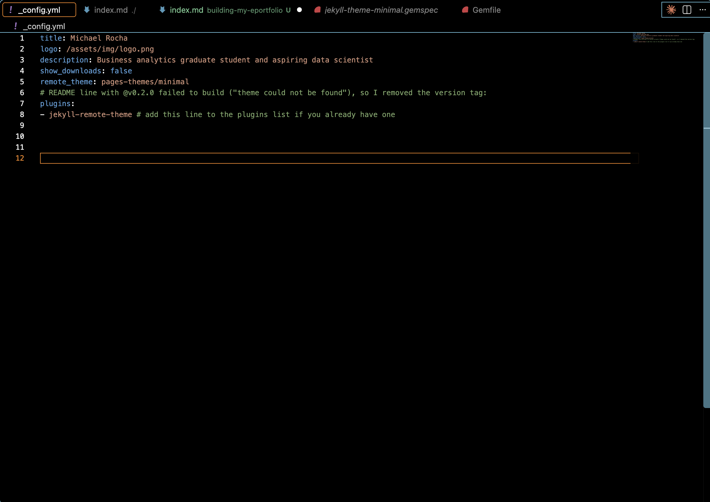
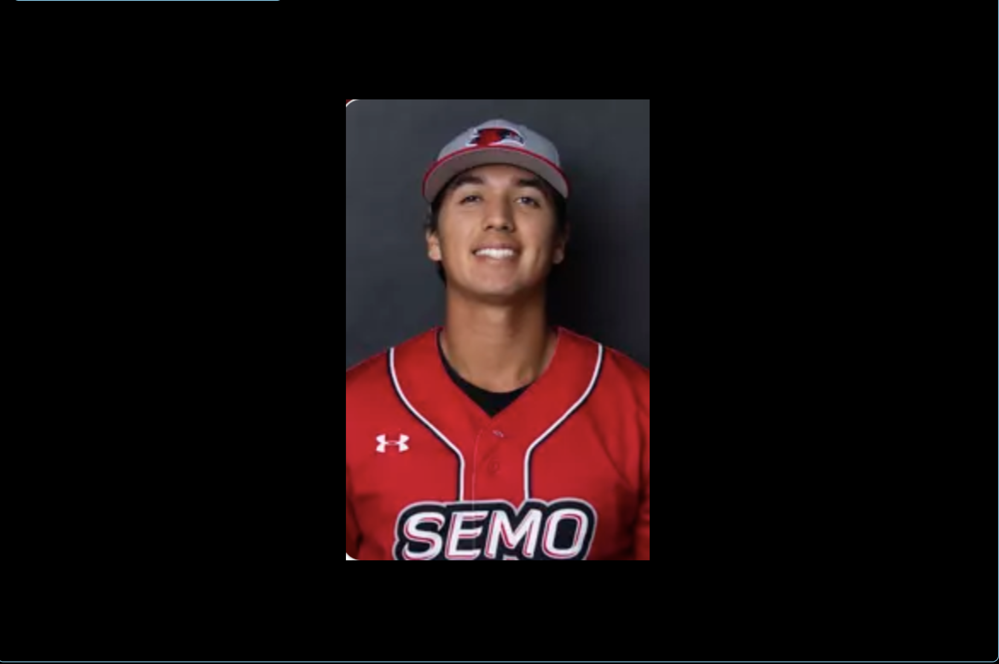
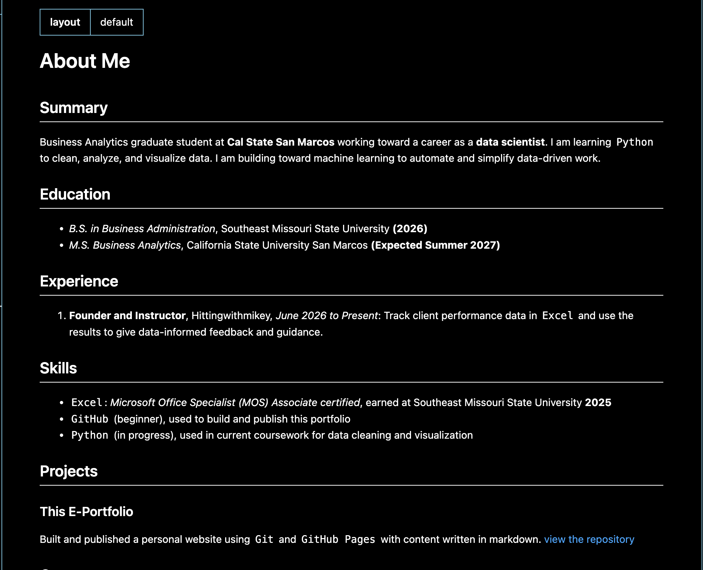
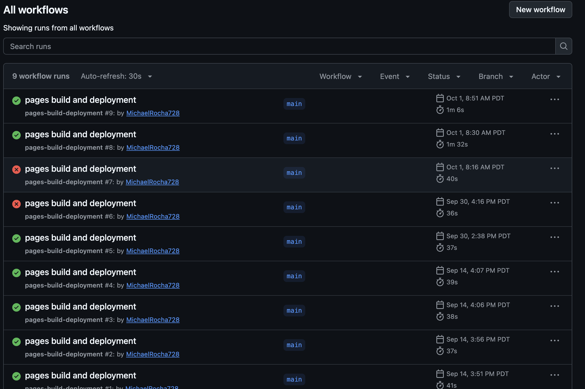
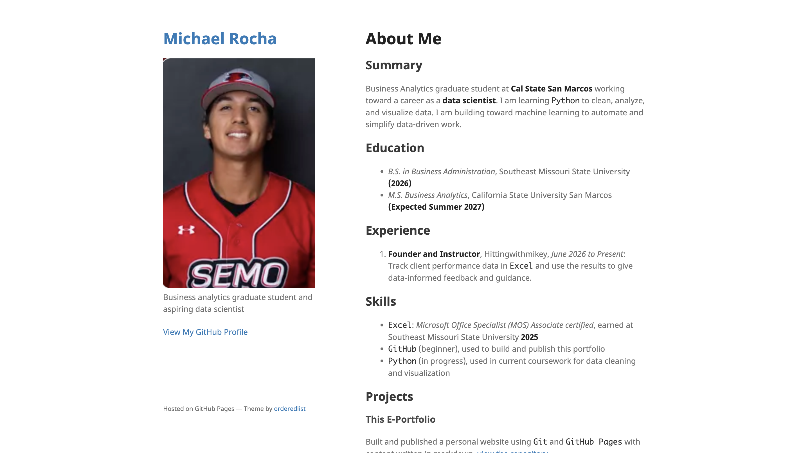

# How I Built My E-Portfolio on GitHub Pages

## Introduction

An e-portfolio is a personal website where someone can display personal skills, education, and projects in one place. I built mine using GitHub Pages, along with the Minimal theme. This guide walks through every step I took, from creating my repository to publishing my finished site, including the problems I ran into and how I fixed them.

## Step 1: Creating a GitHub Account and Repository

The Github account was created in class with the help of professor Karimi, shortly after I created the new repository and named it MichaelRocha728.github.io. After I had the name I made it public 

## Step 2: Cloning the Repository to My Computer

To clone the repository to my computer I used the terminal application

```
cd ~/Documents
git clone https://github.com/MichaelRocha728/MichaelRocha728.github.io.git
```

## Step 3: Adding the Minimal Theme

To apply the minimal theme I downloaded the entire minimal project from the GitHub page 
[github.com/pages-themes/minimal](https://github.com/pages-themes/minimal)
After I had the download I unzipped it and put the files into the MichaelRocha728.github.io folder.

### Troubleshooting: Push Rejected

I ran into an issue with my first push because an error was halting the project. The .github folder needed workflow permission that my token did not have.
My response was to remove the folder and push again. 
The push worked once the folder was removed, and the site ran because it did not need that folder.

### Publishing the Theme 

After adding the files, I committed and pushed them in Terminal.

```
git add . 
git commit -m "Add minimal theme"
git push
```

What this did is select then save the theme files with a message and then uploaded them to GitHub to update the site. 

## Step 4: Customizing the Theme

### Editing Site Settings

`config.yml` holds the settings for the site and I was able to set it up following the README's instructions.

```yaml
title: Michael Rocha
logo: /assets/img/logo.png
description: Business analytics graduate student and aspiring data scientist
show_downloads: false
remote_theme: pages-themes/minimal
plugins:
  - jekyll-remote-theme
```

These settings gave my web page a header with my name and a short description that gives visitors quick background about me. They also control where my headshot photo appears.

The `remote_theme` line specifies that I want to use the Minimal theme, and the `plugins` line turns on the tool that lets GitHub load that remote theme.

The README's version with @v0.2.0 failed to build, so I removed the version number in order for it to push.



### Replacing the Logo with My Headshot

I replaced the stock logo with a photo of myself in the assets section by going through the img subsection, while keeping the file name. 



### Rewriting the Homepage

I replaced the theme's sample index.md with my own content, organized like a resume, and then listed the sections(About Me, Experience, Skills, Projects, Coontact.)

I then used Markdown features such as italic, bold, inline code, and links when I linked the repository.

As well as headers and unordered lists.



## Step 5: Publishing and Checking the Site

### Making the Final Commit

After finishing the customizations, I committed and pushed all changes using the same commands as Step 3.

```
git add .
git commit -m "Customize e-portfolio"
git push
```

### Checking the Deployment

I went to your repository on GitHub, opened the Actions tab, and confirmed that "pages build and deployment" finished with a green checkmark, meaning the site built successfully.



### Viewing the Live Site

After I visited MichaelRocha728.github.io to confirm the changes were live.

## Final Result

Here is my finished portfolio




## References

Anthropic. (2026). *Claude* (Opus 5.5, Oct 29 version) [Large language model]. https://claude.ai

GitHub. (n.d.). *Minimal theme* [Source code]. Retrieved October 29, 2026, from https://github.com/pages-themes/minimal

CircleCI. (n.d.). *What is YAML? A beginner's guide*. Retrieved October 29, 2026, from https://circleci.com/blog/what-is-yaml-a-beginner-s-guide/

Microsoft. (n.d.). *Markdown and Visual Studio Code*. Retrieved October 29, 2026, from https://code.visualstudio.com/docs/languages/markdown


### Use of AI

I used Claude (Anthropic, 2026) as a support tool while writing this guide. Claude  helped me organize the guide's outline, reviewed my drafts, and suggested grammar and wording corrections, and the explanations are my own.